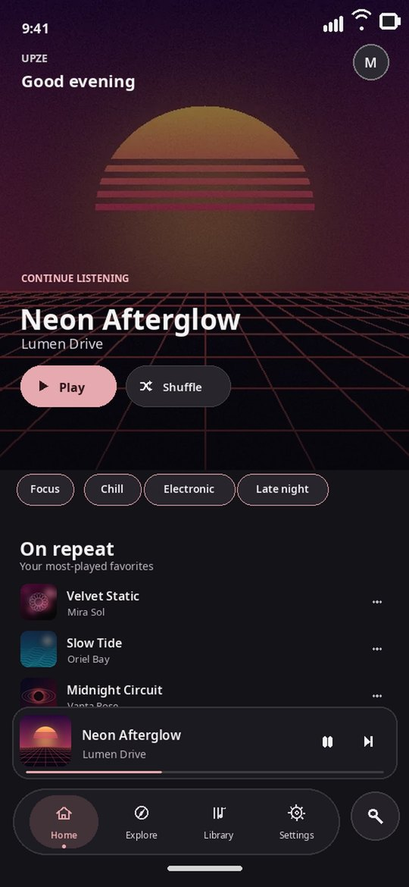
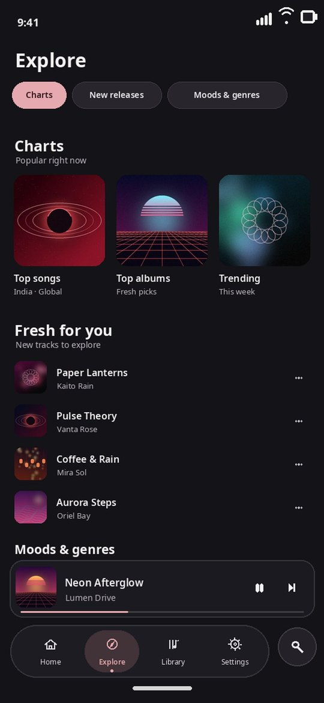
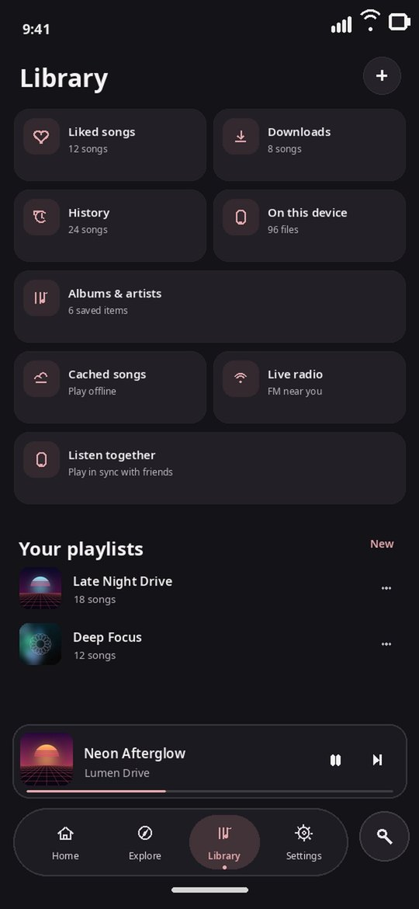
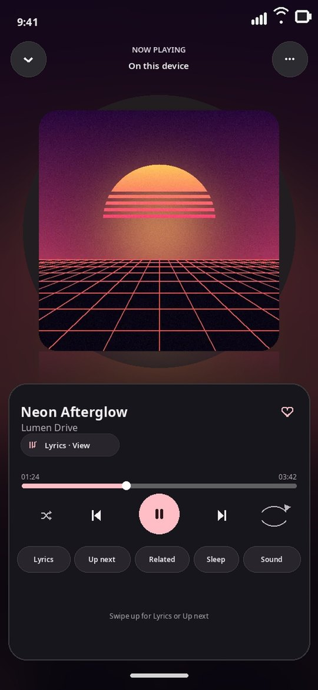
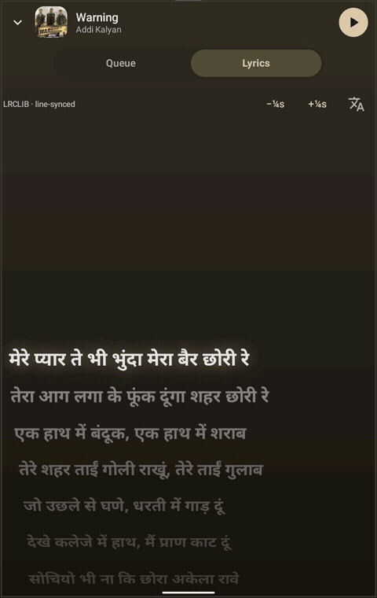
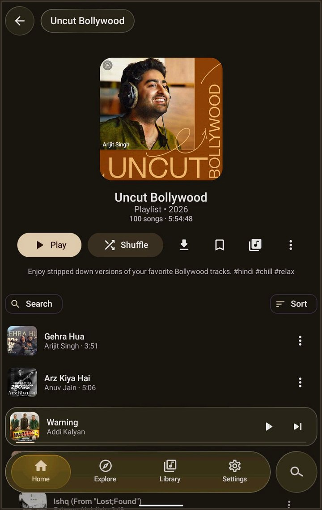

<div align="center">


# UpZe

**A free, open-source music player for Android (plus an experimental iOS build) that streams legal catalogues, plays your own files and servers, and runs every song through a real sound engine.**

[-3DDC84?logo=android&logoColor=white)](#download--install)
[](#ios-iphone--ipad)
[](https://kotlinlang.org)
[](https://developer.android.com/compose)
[](LICENSE)
[](https://github.com/kulana121-bit/UpZe-music/releases)

[Download](https://github.com/kulana121-bit/UpZe-music/releases) · [Features](#features) · [Build](#build-from-source) · [Contributing](CONTRIBUTING.md) · [Changelog](CHANGELOG.md)

</div>

---

UpZe (formerly MusicSpot) is written in Kotlin with Jetpack Compose and AndroidX Media3. It plays from YouTube Music,
JioSaavn and other free catalogues, from the music on your phone and from your own Subsonic/Navidrome or Jellyfin
server, imports your Spotify and YouTube Music libraries, and gives you an EQ, AutoEq headphone profiles and an honest
upscaler. No ads, no telemetry, no account required.

The project also has an **experimental iOS build**: the Kotlin Multiplatform + Compose Multiplatform port lives in
[UpZe-KMP](https://github.com/kulana121-bit/UpZe-KMP), and the latest release carries the Android APK, and the v1.02 release carries the iOS IPA (see [iOS install](#ios-iphone--ipad)). Both platforms share one identity — package/bundle ID
`com.ravi.musicspot` — so updates always install in place and keep your data.

## Preview

<div align="center">

| Home | Explore | Library |
|:---:|:---:|:---:|
|  |  |  |

| Now Playing | Motion Lyrics | Playlist |
|:---:|:---:|:---:|
|  |  |  |

</div>

> **Preview disclaimer:** The screenshots above are app-preview samples shared only to showcase UpZe's interface
> and features. The songs, artist names, album artwork and other content visible in them are shown for
> demonstration purposes only, belong to their respective owners, and are **not** distributed with this app or
> this repository — UpZe hosts no music (see [Disclaimer](#disclaimer) below).

## Features

### Playback sources
| Source | What it gives |
|---|---|
| YouTube Music (Innertube, NewPipe Extractor fallback) | Full catalogue, Opus ~160 kbps; 256 kbps with a signed-in Premium account |
| JioSaavn | Catalogue, 320 kbps AAC where available; automatic fallback when YouTube refuses a stream |
| Monochrome (Tidal HiFi) | True lossless FLAC (16-bit/44.1 kHz); a stream is only labelled lossless after its FLAC header checks out |
| Qobuz (lossless proxy) | Lossless FLAC through community proxy endpoints |
| NetEase Cloud Music | Large Chinese and international catalogue |
| Live radio | Thousands of stations via Radio Browser; live only — never cached or downloaded |
| Audius · Jamendo · Internet Archive | Official APIs; FLAC where offered (Jamendo needs your free client_id) |
| SoundCloud | Via NewPipe Extractor (off by default; currently broken upstream) |
| On this device | FLAC/ALAC/WAV/hi-res files through MediaStore |
| Subsonic / Navidrome, Jellyfin | Your own server; original files in Lossless mode |
| Spotify | Library **metadata only** (import/sync); songs play from a matched source |

Sources can be switched on/off and re-ordered. The router plays from your priority order and fails over to the next
match when a source can't play a song (ISRC when present, otherwise title/artist/duration with remix/live/cover guards).
Queue with reorder, play next, shuffle, repeat, Infinite play, gapless or 0–12 s crossfade; sleep timer with fade;
downloads (WorkManager, Wi-Fi-only option) and an offline mode.

### Sound engine & EQ
- Software engine inside ExoPlayer: 10-band graphic EQ, parametric EQ, presets, A/B bypass, preamp with auto headroom,
  bass boost, stereo widener and a peak limiter.
- AutoEq headphone profiles, searched and fetched on demand.
- Enhance: windowed-sinc upscaler to 48/96/192 kHz (only rates your output supports), bandwidth extension and transient
  restore — labelled "Upscaled"/"Enhanced", never "Lossless".
- **3D Sound (Spatial 3D)**: HRTF-style spatial rendering for headphones — widening, crossfeed, pinna cues and a
  synthetic room, with an intensity slider. Virtual speakers for stereo; never labelled Atmos.
- Pure hi-res output, and bit-perfect USB DAC mode on Android 14+.

### Lyrics
- Word-by-word first: Musixmatch (RichSync), LyricsPlus, KuGou (KRC), QQ Music (QRC) and NetEase (YRC) provide
  word-timed lyrics; then line-synced LRCLIB and AMLL (TTML), with JioSaavn, Lyrics.ovh and YouTube Music as
  fallbacks. Providers are asked in your order and the best sync available wins.
- Synced and enhanced LRC, instrumental-break dots, romanisation, ±3 s offset, disk cache.
- **Motion Lyrics** mode: a kinetic full-screen lyric stage over the artwork, driven by the engine's own beat and
  tone metering.

### UI, dock & motion
- Material 3 with dynamic colour from the artwork; Dark, Light, System and Pure black themes.
- Liquid-glass surfaces (lens refraction on Android 13+, blur on 12, tinted fallback on older devices).
- Several Home, Now Playing and dock designs to pick from at first launch or in Settings › Appearance.
- One shared Material-motion spec for sheets, dialogs, menus and page transitions; Reduce motion makes them instant.
- Tablet layout with a side rail.

### Home-screen widget
- Now-playing widget with artwork-tinted card, title/artist and previous / play-pause / next.

### Accounts & updates
- Optional Google (YouTube Music library) and Spotify sign-in through locked-down WebViews; cookies are encrypted with
  an Android Keystore key and excluded from backups. Everything works as a guest.
- Built-in updater: checks GitHub Releases (at most every 12 h, or from Settings › About › Check for updates), shows
  the release notes, downloads the APK and hands it to the system installer.
- On iOS, updates arrive through the AltStore/SideStore source (see [iOS install](#ios-iphone--ipad)) and install in
  place under the same bundle ID.

## Download & install

1. Open the [latest release](https://github.com/kulana121-bit/UpZe-music/releases) and download `UpZe-vX.Y.Z.apk`.
2. Open the APK on your phone. If asked, allow your browser or file manager to **install unknown apps**.
3. Tap **Install**. Later versions install over it and keep your data, and the app tells you when one is out.

Requirements: Android 8.0 (API 26) or newer (one APK for arm64-v8a, armeabi-v7a, x86 and x86_64).

> Coming from MusicSpot? UpZe keeps the package name `com.ravi.musicspot` and the same signing key, so it installs
> over MusicSpot 2.0.x and keeps your library, settings and sign-ins.

### Android — F-Droid (automatic updates, no account)

UpZe also has its own F-Droid repository, so the F-Droid app can install it and deliver updates automatically:

1. Install the **F-Droid** app from [f-droid.org](https://f-droid.org) if you don't have it yet.
2. In F-Droid, open **Settings → Repositories → +** and add this address:
   `https://kulana121-bit.github.io/upze-fdroid-repo/repo?fingerprint=3FAD223C53DB20A0C3EEC33A825F6A3786A7FC8EF501ADDE0930EFB3DD93A8C6`
3. Search for **UpZe** and install it.

Repository fingerprint (SHA-256): `3FAD223C53DB20A0C3EEC33A825F6A3786A7FC8EF501ADDE0930EFB3DD93A8C6`. The APKs in the repo are signed with the same permanent key as the GitHub releases above, so an F-Droid install updates a GitHub install in place (and the other way round) with your library and settings intact.

### iOS (iPhone & iPad)

An experimental iOS 15+ build exists, built from the shared Kotlin Multiplatform codebase in
[UpZe-KMP](https://github.com/kulana121-bit/UpZe-KMP). The iOS build is an **unsigned IPA**, so it is installed with a
sideloading tool instead of the App Store.

**Honest status: this iOS build has not yet been tested on a real iPhone or iPad. Android is the primary, supported platform.**

**Option 1 — AltStore or SideStore (recommended, updates included)**

1. Install [AltStore](https://altstore.io) or [SideStore](https://sidestore.io) on your iPhone/iPad and finish its setup.
2. In AltStore/SideStore open **Sources** and add this source:
   `https://raw.githubusercontent.com/kulana121-bit/UpZe-KMP/main/apps.json`
3. Install **UpZe** from that source. New versions appear inside AltStore/SideStore and update in place — your
   library and settings are kept.

**Option 2 — Sideloadly (one-time install from a computer)**

1. Download `UpZe-vX.Y.Z.ipa` from the [latest release](https://github.com/kulana121-bit/UpZe-music/releases).
2. Install Sideloadly on your computer, connect your iPhone/iPad, sign in with your Apple ID, drag in the IPA and
   press **Start**.

Good to know:

- UpZe uses the same identity on iOS as on Android — bundle ID `com.ravi.musicspot` — and it never changes, so every
  iOS update installs over the previous version without losing data. Always sign/install updates with the same
  Apple ID and the same tool you used the first time.
- With a free Apple ID, sideloaded apps expire after 7 days; AltStore/SideStore refresh them automatically in the
  background. A paid Apple Developer account extends this to one year.
- The IPA is unsigned by design: your sideloading tool signs it with your own Apple ID during install. Only download
  the IPA from this repository's releases — never from unofficial mirrors.

## Build from source

Requirements: JDK 17+, Android SDK with platform 37 and build-tools 36.0.0, and network access to Google Maven, Maven
Central and JitPack (NewPipe Extractor).

```sh
git clone https://github.com/kulana121-bit/UpZe-music.git
cd UpZe-music
./gradlew :app:assembleDebug          # debug APK: app/build/outputs/apk/debug/ (package com.ravi.musicspot.debug)
./gradlew :app:testDebugUnitTest      # JVM + Robolectric unit tests
./gradlew :app:lintDebug              # Android lint (NewApi is an error: minSdk 26 must keep working)
```

Release builds are signed with the project's permanent key, which is **never** in this repository. Point the build at
a properties file with `storeFile`, `storePassword`, `keyAlias` and `keyPassword`:

```sh
MUSICSPOT_KEYSTORE_PROPERTIES=/path/to/keystore.properties ./gradlew :app:assembleRelease
# or: ./gradlew :app:assembleRelease -PkeystoreProperties=/path/to/keystore.properties
# or: ./gradlew :app:assembleRelease -PunsignedRelease=true   (unsigned APK)
```

The release build fails rather than fall back to the debug key.

### Releasing a new version

1. Bump `versionCode` (must always increase) and `versionName` in `app/build.gradle.kts`, and add a `CHANGELOG.md` entry.
2. Build `:app:assembleRelease` signed with **the same key** as every earlier release (Android refuses an update
   signed with a different key) and keep the R8 `mapping.txt`.
3. Create a GitHub Release with the tag `vX.Y.Z` (matching `versionName`), paste the changelog entry as the notes, and
   attach the signed APK (`UpZe-vX.Y.Z.apk`). Don't mark it as a pre-release.
4. Installed copies find it through the in-app updater (`/releases/latest`, first `.apk` asset).

## Project structure

```
app/src/main/java/com/ravi/musicspot/
├── App.kt, MainActivity.kt   Process-wide Graph (stores, sources, player), entry activity
├── account/                  Encrypted account store, Google/Spotify sessions, library sync
├── core/                     HTTP client, crash guard, encryption, JSON files, playback log, links
├── data/                     Settings, library, downloads, home feed, play stats, AutoEq
├── dsp/                      Sound engine: EQ, limiter, resampler, enhancers
├── logic/                    Pure logic: queue, sleep timer, search, taste, contrast
├── lyrics/                   Lyrics providers, LRC parsing, romaniser, cache
├── playback/                 MediaSessionService, ExoPlayer setup, chunked data source, engine processor
├── source/                   Music sources and the router (YouTube, JioSaavn, local, servers, …)
├── spotify/                  Spotify library import (metadata only)
├── ui/                       Compose UI: screens, player designs, docks, settings, motion, glass, theme
├── update/                   In-app updater (GitHub Releases)
├── widget/                   Home-screen now-playing widget
└── yt/                       YouTube Music Innertube client, parser, stream resolver, NewPipe bridge
app/src/test/                 Unit tests (routing, DSP, lyrics, logic, updater, Robolectric start-up)
```

The Kotlin package stays `com.ravi.musicspot` so existing installs upgrade in place.

The cross-platform version of this same project lives in [UpZe-KMP](https://github.com/kulana121-bit/UpZe-KMP): one
`composeApp` module with `commonMain` (shared UI, sources, lyrics and sound-engine logic), `androidMain` and `iosMain`
platform layers, plus a thin SwiftUI host app for iOS.

## Tech stack

Kotlin 2.4 · Jetpack Compose & Material 3 · Kotlin Multiplatform & Compose Multiplatform for the iOS build
([UpZe-KMP](https://github.com/kulana121-bit/UpZe-KMP)) · AndroidX Media3 (ExoPlayer, MediaSession) · Kotlin coroutines & Flow ·
kotlinx.serialization · OkHttp · Coil 3 · WorkManager · NewPipe Extractor · Kyant Backdrop & Haze · Gradle 9.5 with
AGP 9.3 · JUnit 4 & Robolectric.

## Roadmap

- [x] iOS app (experimental, not yet device-tested) — Kotlin Multiplatform build, distributed as a sideload IPA with an AltStore/SideStore source
- [x] F-Droid distribution — own F-Droid repo with automatic updates (official F-Droid catalogue listing still pending)
- [ ] Android Auto browsing
- [ ] More widget sizes and a lock-screen lyrics view
- [ ] Translations
- [ ] Fix SoundCloud once NewPipe Extractor supports it again

Ideas and votes are welcome in [issues](https://github.com/kulana121-bit/UpZe-music/issues).

## Contributing

Bug reports, ideas and pull requests are welcome. Please read [CONTRIBUTING.md](CONTRIBUTING.md) and the
[Code of Conduct](CODE_OF_CONDUCT.md) first. Security problems: see [SECURITY.md](SECURITY.md).

## Credits

UpZe stands on the shoulders of these projects (full list in [THIRD_PARTY_NOTICES.md](THIRD_PARTY_NOTICES.md)):

- [OpenTune](https://github.com/Arturo254/OpenTune) — Innertube parser, player clients, lyrics providers, player panes (GPL-3.0)
- [NewPipe Extractor](https://github.com/TeamNewPipe/NewPipeExtractor) — YouTube stream extraction fallback (GPL-3.0)
- [AndroidX Media3 / ExoPlayer](https://github.com/androidx/media) — playback and media session (Apache-2.0)
- [Kyant Backdrop](https://github.com/Kyant0/AndroidLiquidGlass) and [Haze](https://github.com/chrisbanes/haze) — liquid glass and blur (Apache-2.0)
- [AutoEq](https://github.com/jaakkopasanen/AutoEq) — headphone correction profiles (MIT)
- [LRCLIB](https://lrclib.net) — synced lyrics
- [Coil](https://github.com/coil-kt/coil), [OkHttp](https://github.com/square/okhttp), [kotlinx](https://github.com/Kotlin) — images, networking, serialization, coroutines

## License

UpZe is free software: you can redistribute it and/or modify it under the terms of the
[GNU General Public License v3.0](LICENSE) or (at your option) any later version. It includes code from GPL-3.0
projects (OpenTune, NewPipe Extractor), so derivatives must stay GPL-3.0 as well.

## Disclaimer

UpZe hosts no music. It plays streams from services you choose to enable, your own files and your own servers. It does
**not** stream audio from Spotify (Spotify is used for library metadata only), does not use rip proxies or torrents,
and does not bypass DRM or use torrents. The optional Monochrome and Qobuz sources fetch lossless streams through
community endpoints; enable only the sources you are comfortable using. Respect the terms of service of every
service you use and the copyright of the music you play.
UpZe is not affiliated with YouTube, Google, JioSaavn, Spotify or any other service it can connect to.

## Developer

Made by **Ravi**.

- GitHub: [kulana121-bit/UpZe-music](https://github.com/kulana121-bit/UpZe-music)
- Instagram: [@jus7_rv](https://www.instagram.com/jus7_rv/)
